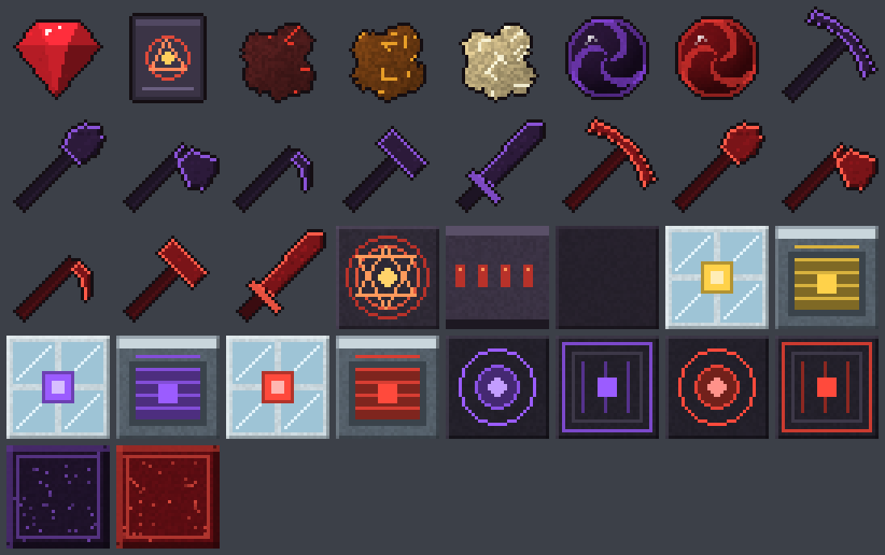

# Vintage-E

**Equivalent exchange for [Vintage Story](https://www.vintagestory.at/) 1.22**, inspired by the Minecraft mod [ProjectE](https://github.com/sinkillerj/ProjectE).

Burn items into **EMC**, learn them, and transmute your EMC back into anything you've learned. Every block and item gets its EMC value **worked out automatically from the recipes loaded in your game** when the server starts — so items added by other mods get values too, without anyone writing a compatibility patch.



## What's in it

| | |
|---|---|
| **Philosopher's Stone** | Right-click a block to transmute it: rock types cycle (granite → andesite → basalt …), wood types cycle, sand ↔ gravel, bare soil ↔ grassy soil, water ↔ ice. Sneak to go backwards. Press the tool-mode key (**F**) for 1×1, 3×3 or 5×5. Also the catalyst for the alchemy recipes (never used up). |
| **Transmutation Table / Tablet** | Drop items on the **burn slot** to turn them into EMC and learn them. Then click anything you've learned to create it from your EMC (left-click: one, right-click: a stack, shift-click: a stack straight into your inventory, Ctrl + right-click: forget it). Searchable, paged, most valuable first. The tablet works anywhere. Items that hold things or keep their material on the item can be learned and created as exactly that version (see below). |
| **Alchemical Coal → Mobius Fuel → Aeternalis Fuel** | Each tier is 4× the last. Hotter and much longer burning than charcoal; they work in forges and fire pits. |
| **Dark Matter / Red Matter** | Plus blocks of each. |
| **Matter tools** | Pickaxe, shovel, axe, sword, hoe and **sledgehammer** in dark and red matter, as 3D tools held, swung and displayed like the game's own (they use the vanilla tool models and animations with matter textures; the sledgehammer has its own model). They **never wear out**. The pickaxe/shovel/axe dig 1×1 by default and 3×3 (dark) or up to 5×5 (red) with the tool-mode key **F**; the sledgehammers smash stone and ore **3×3 from the start** (red: 5×5 with **F**). Sneak to dig a single block. The axe still fells trees and the hoe still tills. |
| **Energy Collectors MK1–MK3** | Turn sunlight into EMC (4 / 12 / 40 EMC per second in full sun). They push it into a condenser next to them, or sneak + right-click with an empty hand to take it into your personal EMC. |
| **Energy Condensers MK1–MK2** | Put an item in the target slot. The condenser burns everything else inside it (plus EMC from collectors) and makes copies of the target. Works with hoppers and chutes; automation only pulls out the finished copies. |
| **Klein Stars** | Ein → Omega (50k to 51.2M EMC). Portable EMC: right-click to empty into your EMC, sneak + right-click to fill. Rings and gadgets draw from carried stars. Can be worn in the **emblem** slot, where it shows on your chest and still counts as carried. |
| **Rings, stones, amulets** | Black Hole Band, Swiftwolf's Rending Gale (flight, shield and 1x–3x speed), Harvest Goddess Band, Ignition Ring, Zero Ring, Ring of Arcana (every effect switchable on its own), Void Ring, Body/Soul/Life Stones, Repair Talisman, Gem of Eternal Density, Evertide and Volcanite Amulets, Watch of Flowing Time. They work from your hotbar or backpack; right-click switches them on/off. The rings can also be worn in the **arm** slot, where they show on your wrist and keep working. |
| **Gadgets** | Destruction Catalyst, Hyperkinetic and Catalytic Lenses (explosive charges), Mercurial Eye, Archangel's Smite (homing arrows), Tome of Knowledge, Divining Rods. Lenses, amulets and the Ignition Ring shoot with the **fire-projectile key (R)**. |
| **Armour** | Dark Matter, Red Matter and Gem armour (head, body, legs) that never wears out and makes no clanking noise; full gem armour stops fall and fire damage. |
| **More tools** | Dark/Red Matter Shears, Red Matter Katar, Red Matter Morning Star. |
| **Storage and machines** | Alchemical Chest (104 slots), Alchemical Bags (32-slot backpack bags), fuel blocks, Dark/Red Matter Furnaces (hotter, faster firepits that can run on EMC), Anti-Matter Relays MK1–3, Dark Matter Pedestal, Nova Catalyst/Cataclysm, Interdiction Torch. |

Hover any item to see its EMC in the tooltip. Liquids show EMC **per litre** (1 L of water = 1 EMC), and buckets, bags and pots also show what their contents are worth.

When you join, chat shows a summary such as `Vintage-E version 1.7.0: calculated 14055 EMC values, 0 missing.` (turn off with `AnnounceInChat`).

## How EMC values are calculated

Nothing is hard-coded per item. When the server reaches the "run game" phase (after every mod has loaded its recipes) Vintage-E:

1. **Seeds a short list of base values** for raw materials — rocks, soil, sand, logs, clay, ore nuggets, ingots, coal, gems, food, hides (see [`assets/vintagee/config/vintagee-emc.json`](assets/vintagee/config/vintagee-emc.json)).
2. **Collects every way of making things** the loaded mods define:
   - crafting-grid recipes;
   - every recipe list held by **any loaded mod** whose recipe type implements the game's `IRecipeBase` interface — that covers vanilla smithing, knapping, clay forming and barrel recipes *and* custom recipe types from other mods, found automatically by reflection;
   - alloy recipes (copper + tin → bronze, by ratio);
   - item properties: smelting/firing/cooking, quern grinding, pulverizer crushing, and drying, curing, ripening, hardening, melting and other transitions;
   - clay-oven baking, the fruit press and the still (read from item attributes, so mods using the same attributes are covered);
   - **casting**: pouring metal into a tool mold costs the mold's `requiredUnits` of that metal (100 units = 1 ingot), shared among what it drops; the mold itself only costs something if it breaks when filled;
   - **processes with several outputs**, read from the behaviours' own settings: squeezing (honeycomb → honey + beeswax), ground-storage processing such as sawing logs into boards (`processedStacks` plus any `remainingItem`), and the fruit press (juice + pressed leftovers). The input's value is shared out so the process neither creates nor destroys EMC: outputs that already have a value keep it, the rest is split evenly;
   - **block drops**: a natural block (ore, crop, plant, clay…) is worth what it drops, and a block that drops one kind of item values that item;
   - **placement states**: blocks that only exist placed (facing another way, snow-covered, a fence joined to its neighbours, an open gate) are worth exactly the item they turn back into when picked or broken.
   Smithing and clay forming cost the whole ingots/clay you have to put on the anvil (42 voxels per ingot, 25 per clay), because split-off voxels are lost. Tools used in a recipe (saws, the philosopher's stone…) cost nothing; returned items (buckets…) are subtracted.
3. **Propagates values through that graph**: each item gets the *cheapest* value any recipe produces, so crafting something and burning it can never earn more EMC than its ingredients. When an ingredient accepts several items (wildcards, tags) the cheapest valued one is used. Self-cheapening recipe loops are detected and frozen at their first value.
4. **Adds time**: items that transform on their own over time get a bonus per in-game day it takes (fresh + transition hours). By default drying adds **64 EMC per day** (tall grass that takes a day to dry makes dry grass worth 64 more). Set per transition type with `TransitionEmcPerDay` in the config (`dry`, `cure`, `ripen`, `harden`, `melt`, `convert`).
5. **Works backwards where it can**: if an ore chunk or a raw food has no value but what it smelts/dries/grinds into does, its value is inferred from the output. The same goes for crafting: if a recipe's result has a value and only one ingredient doesn't (loot parts, gold jewellery that breaks down into gold bits…), that ingredient gets what's left over (the highest such value, so nothing that already had a value gets cheaper).
6. **Applies ratio rules** from the value files (`relativeValues`) to anything still unvalued — e.g. a metal bit is worth 1/20 of the matching ingot (5 of its 100 metal units), aged or cracked stone bricks are worth the same as normal ones.
7. **Uses trader prices** for things no recipe makes (clothes, loot armour, decorations…). What one rusty gear is worth is *measured* each start from items traders deal in that already have a value (the median of value ÷ price), and the rusty gear itself is set to that, so selling goods for gears and burning the gears can't create EMC.
8. **Fills remaining gaps from variants**, using the variant groups each block/item type defines. A value is copied freely across groups that only change the look or placement (rock, colour, wood, facing, snow cover…): the same ore in a different rock, the same bricks in another colour. It is **never** copied across groups that change what something is (ore, metal, material, mold type…), so cinnabar ore isn't priced like gold-bearing quartz; those stay unvalued and show in `/emc missing`. Other mods' variants of a base-game family (their own wood types for the game's logs, say) borrow the base game's value the same way.
9. **Estimates from what a thing does**: a fuel nothing else values is worth how hot and how long it burns, at the rate charcoal and coal are valued at; a food is worth how filling it is, at the rate valued food of the same kind (fruit, vegetable, protein, grain, dairy) is.
10. **Guesses across the remaining variant groups** (those in neither list, like a clothes slot's types), taking the *middle* value of the variants so one odd one can't set the rest.
11. **Falls back to `defaultValues`** in the value files: family-level values for natural blocks (coral, seaweed, termite mounds…), ruin decorations and loot that nothing else could value. Recipes always win over these.

After each of steps 6–11 the recipe graph is solved again, so anything made from newly valued things gets its real recipe value before a rougher step guesses at it. `/emc dump` shows which step valued each item.

Soil is worth more the more fertile it is (very low 1 → terra preta 16), and so is farmland.

Self-cheapening recipe loops (where values would creep down every time round) are detected and frozen at their first value.

The finished table is sent to every client.

### Caching

Mapped values are saved per world in `VintagestoryData/ModData/vintagee/cache/` and reused on the next start, so the mapping only runs when something that affects values has changed. That's decided by a fingerprint over every input: the game version, the loaded mods and their versions, this mod's own code, `ModConfig/vintagee.json`, the merged value files, every block/item with its smelting/grinding/crushing/transition/drop/baking/press/still data and `emcValue`, every crafting-grid recipe and every recipe/alloy list any mod holds. Change any of those (add a mod, update one, edit a recipe or the config) and the next start remaps and refreshes the cache. The server log says which happened (`EMC values loaded from cache…` or `EMC mapped…`). `/emc recalc`, `/emc set` and `/emc clear` always remap; set `CacheEmcValues` to `false` to never use the cache.

### Checking that everything has a value

Every time values are mapped, the server log reports coverage in this form:

```
EMC coverage: <valued> of <total> blocks/items in the creative inventory have a value (<percent>%).
EMC: <n> without a value, by family: <domain:family> (<count>), ...
```

The full list is written to `VintagestoryData/ModData/vintagee/emc-missing.csv`, and admins can run `/emc missing` in game to open a **searchable, scrollable list** with item icons, filters by mod and by blocks/items, and a button that copies the codes ready to paste into `BaseValues`. Clicking an icon opens its handbook page. Click names to select several (or **Select shown** for everything the filters show) and give them all one value or blacklist them in one go; with a mod picked in the mod filter, **Blacklist whole mod** blacklists everything from that mod (saved as `modid:*`). Give anything on it a value with `BaseValues` in `ModConfig/vintagee.json` (or `/emc set` while holding it), then `/emc recalc`. If you really want *every* listed block and item to have some value, set `FallbackValue` — but anything valued that way can be created for that price, so a small number makes rare loot cheap.

Deliberately left without a value (so they can't be duplicated or burned): creative/debug/technical blocks, work-in-progress items, loot containers, liquid blocks, and story-progression devices (the return-base items, etc.), creatures and NPCs from any mod (live butterflies and fish excepted, since you can catch them), and maps. The list is the `blacklist` in the default value file.

## Items that hold things or keep their material

Some items carry data on the item itself: buckets, jugs, pots, bowls, crocks, barrels and bags hold things; round shields keep their metal and wood, lanterns their metal, lining and glass, chests and clutter their type, chiseled blocks their design. Each of these uses one of three modes:

| Mode | Burning gives | Learning and creating |
|---|---|---|
| **Item only** | the plain item's value (a container that still holds something won't burn) | the plain item |
| **Item + contents** | the item plus what it holds or is made of (a gold round shield is worth more than a tin bronze one; a chiseled block is worth its voxels of each material) | exactly that version |
| **Item price only** | the item and its material, not what it holds | exactly that version, for the item's price: contents are free |

Built-in defaults: containers are **item only**; items whose material or type lives on the item, and chiseled blocks, are **item + contents** (a plain copy of those would be the wrong or default version). Admins change them with **`/emc contents`**, a window listing every such block/item with its mode (search, filter by mod, kind and mode, select several, then pick a mode or *Default*), or `/emc contents <item|full|itemprice|default>` for the held item. Changes are saved to `StackDataModes` in the server config and apply straight away. Copies never include wear, freshness or clothing condition: they come out new. Condensers follow the same modes for their target. Each player can know up to `MaxExactKnowledge` (500) exact versions.

## For modpack makers and mod authors

Values come from these sources, later ones winning:

1. `assets/vintagee/config/vintagee-emc.json` (this mod's defaults).
2. Any other mod's `assets/<modid>/config/vintagee-emc.json` — same format; ship one with your mod, or JSON-patch ours.
3. An `emcValue` attribute on any item or block: `"attributes": { "emcValue": 256 }` (0 = no EMC).
4. `ModConfig/vintagee.json` on the server: `BaseValues` and `FixedValues` (code or wildcard → value), `Blacklist`, and settings like `TransitionEmcPerDay`, `InferValuesFromProcessing`, `InferValuesFromCrafting`, `UseTraderPrices`, `InferFromVariantSiblings`, `FallbackValue`, `CacheEmcValues`, `DumpValuesOnStart`, `AnnounceInChat`, `DurabilityScalesEmc`, `EstimateFuelAndFood`, `StackDataModes`, `MaxExactKnowledge`, `MachineSpeedMultiplier`, `CollectorsChargePlayers`, `TableUseRange`, and the Repair Talisman's clothing settings (`RepairTalismanRepairsClothing`, `RepairTalismanClothingPercentPerMinute`, `RepairTalismanClothingMinCondition`, `RepairTalismanClothingMaxCondition`).

Keys accept wildcards and an optional type prefix: `"game:rock-*"`, `"item:game:stick"`, `"block:*:log-*"`.

Value files can also hold:

- `litreValues` — liquids in EMC per litre (`"game:waterportion": 1`), converted using each liquid's `itemsPerLitre`;
- `relativeValues` rules (`{ "code": "game:metalbit-*", "of": "game:ingot-*", "ratio": 0.05 }`, the `*` part carried over);
- `defaultValues` — values used only when nothing else could value an item;
- `traderCurrency` — items worth exactly what one unit of trader currency buys;
- `blacklist` and `allow` (exceptions to the blacklist);
- `variantGuessing` — `copyAcross` and `neverAcross` lists of variant group codes (`"family:group"` limits one to a family, e.g. `"ore:type"`) and `otherGroups` (`"copy"` or `"never"`);
- `fuelReference` — the fuels whose value per degree-second values unvalued fuels;
- `stackData` — code/wildcard → `"item"`, `"full"` or `"itemprice"`, to change the built-in contents mode for a family;
- the philosopher's stone rules (`worldTransmutation`: `swaps` and `variantCycles`).

`/emc dump` (or `DumpValuesOnStart`) writes every value to `emc-values.csv` (with each block/item's name), the blacklist to `emc-blacklisted.csv` and every item that holds things or keeps its material, with its mode and material-specific values, to `emc-contents.csv`, together with **what it was worked out from** (`grid: 1 game:log-placed-oak-ud -> 12 game:plank-oak`, `trader price: …`, `same as its variant …`), which makes it easy to see why something costs what it does.

### Commands

| Command | Who | |
|---|---|---|
| `/emc` | everyone | Your EMC and the held item's value |
| `/emc help` | everyone | Every command with a short description |
| `/emc set <value>` | admin | Pin the held item's value (0 = remove), saved to the config, remaps |
| `/emc clear` | admin | Remove that pin |
| `/emc recalc` | admin | Re-run the mapper |
| `/emc dump` | admin | Write every value, and where it came from, to `VintagestoryData/ModData/vintagee/emc-values.csv` |
| `/emc dump hand` | admin | Show the held item's value, how it was worked out and what its ingredients are worth (also written to `emc-dump-<item>.txt`) |
| `/emc missing` | admin | Open the searchable list of blocks/items without a value, where you can give one or many of them a value, blacklist them, or blacklist a whole mod (also written to `emc-missing.csv`) |
| `/emc blacklist` | admin | Open the same window for everything on the blacklist: give something a value or take it off the blacklist |
| `/emc contents` | admin | Open the list of everything that holds things or keeps its material, and switch how each is transmuted |
| `/emc contents <item\|full\|itemprice\|default>` | admin | Set the held item's contents mode |
| `/emc add <amount> [player]` | admin | Add personal EMC to a player (yourself if no name is given) |
| `/emc remove <amount> [player]` | admin | Take personal EMC from a player (never below 0) |
| `/emc learn` | admin | Learn the held item without burning it |

## Recipes

| Makes | Pattern (top / middle / bottom) | Key |
|---|---|---|
| 1× Philosopher's Stone | `CGC / GTG / CGC` | C = Copper ingot, G = Gold ingot, T = Temporal gear |
| 1× Transmutation Table | `RSR / SPS / RSR` | R = Any rock block, S = Any stone, P = Philosopher's Stone |
| 1× Transmutation Tablet | `·D· / DTD / ·D·` | D = Dark Matter, T = Transmutation Table |
| 1× Alchemical Coal | shapeless: 1× Philosopher's Stone + 4× Charcoal | |
| 1× Alchemical Coal | shapeless: 1× Philosopher's Stone + 2× Coke | |
| 1× Mobius Fuel | shapeless: 1× Philosopher's Stone + 4× Alchemical Coal | |
| 1× Aeternalis Fuel | shapeless: 1× Philosopher's Stone + 4× Mobius Fuel | |
| 4× Charcoal | shapeless: 1× Philosopher's Stone + 1× Alchemical Coal | |
| 4× Alchemical Coal | shapeless: 1× Philosopher's Stone + 1× Mobius Fuel | |
| 4× Mobius Fuel | shapeless: 1× Philosopher's Stone + 1× Aeternalis Fuel | |
| 1× Iron ingot | shapeless: 1× Philosopher's Stone + 2× Copper ingot | |
| 1× Silver ingot | shapeless: 1× Philosopher's Stone + 2× Iron ingot | |
| 1× Gold ingot | shapeless: 1× Philosopher's Stone + 4× Silver ingot | |
| 2× Copper ingot | shapeless: 1× Philosopher's Stone + 1× Iron ingot | |
| 2× Iron ingot | shapeless: 1× Philosopher's Stone + 1× Silver ingot | |
| 4× Silver ingot | shapeless: 1× Philosopher's Stone + 1× Gold ingot | |
| 1× Diamond (rough) | shapeless: 1× Philosopher's Stone + 4× Emerald (rough) | |
| 4× Emerald (rough) | shapeless: 1× Philosopher's Stone + 1× Diamond (rough) | |
| 1× Dark Matter | `AAA / ATA / AAA` | A = Aeternalis Fuel, T = Temporal gear |
| 1× Red Matter | `AAA / DDD / AAA` | A = Aeternalis Fuel, D = Dark Matter |
| 1× Dark Matter Block | `DD / DD` | D = Dark Matter |
| 1× Red Matter Block | `RR / RR` | R = Red Matter |
| 4× Dark Matter | `B` | B = Dark Matter Block |
| 4× Red Matter | `B` | B = Red Matter Block |
| 1× Dark Matter Pickaxe | `MMM / ·S· / ·S·` | M = Dark Matter, S = Stick |
| 1× Red Matter Pickaxe | `RRR / ·T· / ·D·` | R = Red Matter, T = Dark Matter Pickaxe, D = Dark Matter |
| 1× Dark Matter Shovel | `·M· / ·S· / ·S·` | M = Dark Matter, S = Stick |
| 1× Red Matter Shovel | `·R· / ·T· / ·D·` | R = Red Matter, T = Dark Matter Shovel, D = Dark Matter |
| 1× Dark Matter Axe | `MM· / MS· / ·S·` | M = Dark Matter, S = Stick |
| 1× Red Matter Axe | `RR· / RT· / ·D·` | R = Red Matter, T = Dark Matter Axe, D = Dark Matter |
| 1× Dark Matter Sword | `·M· / ·M· / ·S·` | M = Dark Matter, S = Stick |
| 1× Red Matter Sword | `·R· / ·T· / ·D·` | R = Red Matter, T = Dark Matter Sword, D = Dark Matter |
| 1× Dark Matter Hoe | `MM· / ·S· / ·S·` | M = Dark Matter, S = Stick |
| 1× Red Matter Hoe | `RR· / ·T· / ·D·` | R = Red Matter, T = Dark Matter Hoe, D = Dark Matter |
| 1× Dark Matter Sledgehammer | `MMM / MSM / ·S·` | M = Dark Matter, S = Stick |
| 1× Red Matter Sledgehammer | `RRR / RTR / ·D·` | R = Red Matter, T = Dark Matter Sledgehammer, D = Dark Matter |
| 1× Energy Collector MK1 | `GGG / AOA / III` | G = Any glass block, A = Alchemical Coal, O = Gold ingot, I = Iron ingot |
| 1× Energy Collector MK2 | `GDG / GCG / GGG` | G = Any glass block, D = Dark Matter, C = Energy Collector MK1 |
| 1× Energy Collector MK3 | `GRG / GCG / GGG` | G = Any glass block, R = Red Matter, C = Energy Collector MK2 |
| 1× Energy Condenser MK1 | `IGI / GDG / IGI` | I = Iron ingot, G = Gold ingot, D = Dark Matter |
| 1× Energy Condenser MK2 | `RDR / DCD / RDR` | R = Red Matter, D = Dark Matter, C = Energy Condenser MK1 |

The ProjectE items (Klein stars, rings, gadgets, armour, chest, bags, furnaces, relays, pedestal…) are all crafting-grid recipes too; look them up in the in-game handbook (they're listed in [`assets/vintagee/recipes/grid/projecte.json`](assets/vintagee/recipes/grid/projecte.json)).

Players' EMC and knowledge are saved on the player, so they persist across sessions and deaths.

## Installing

See [CHANGELOG.md](CHANGELOG.md) (also shown on each [release](https://github.com/demonic69/Vintage-E/releases)) for what changed in each version.

Download [`dist/vintagee_1.7.0.zip`](dist/vintagee_1.7.0.zip) and drop it (still zipped) into your `Mods` folder. It's needed on both the server and the clients.

## Building from source

You need the **.NET 10 SDK** and a Vintage Story 1.22 install.

```bash
export VINTAGE_STORY=/path/to/vintagestory      # folder containing VintagestoryAPI.dll
./build/package.sh                               # or build\package.ps1 on Windows
```

That validates the assets, builds `VintageE.dll` and writes `release/vintagee_<version>.zip`. `tools/gen_textures.py` regenerates all textures (they're original pixel art), `tools/gen_mattertools.py` and `tools/gen_sledgehammer.py` regenerate the tool definitions and the sledgehammer model, and `tools/validate_assets.py` cross-checks textures, shapes, recipe codes, class names and lang keys.

### Testing on a real server

The **Test on a real server** workflow (Actions tab → Run workflow) downloads the Vintage Story server, compiles the mod against the game's own DLLs, starts a fresh world with the mod and pushes the results to the `ci-analysis` branch: `emc-values.csv` (every value and where it came from), `emc-missing.csv`, the mod's log lines, and short summaries of the vanilla tool settings used while developing.

### Source layout

| Folder | |
|---|---|
| `src/Emc` | The automatic EMC mapper: `ConversionCollector` (finds recipes), `EmcSolver` (propagates values), `EmcMapper` (ties it together), `EmcRegistry` (runtime lookup + network sync) |
| `src/Transmutation` | Table/tablet GUI and server logic, philosopher's stone world rules |
| `src/Items`, `src/Blocks` | Philosopher's stone, tablet, matter-tool behaviour, collectors, condensers |
| `src/Commands` | `/emc` |
| `assets/vintagee` | Item/block types, recipes, shapes, textures, lang, default EMC values |

## Credits

Inspired by ProjectE by sinkillerj and contributors (and Equivalent Exchange 2 by x3n0ph0b3 before it). This is an independent reimplementation for Vintage Story; no code was copied. The Klein Star textures are ProjectE's own artwork, used under its MIT licence (see [THIRD-PARTY-NOTICES.md](THIRD-PARTY-NOTICES.md)). The matter tools use Vintage Story's own tool models by reference (nothing from the game is included in this mod).
